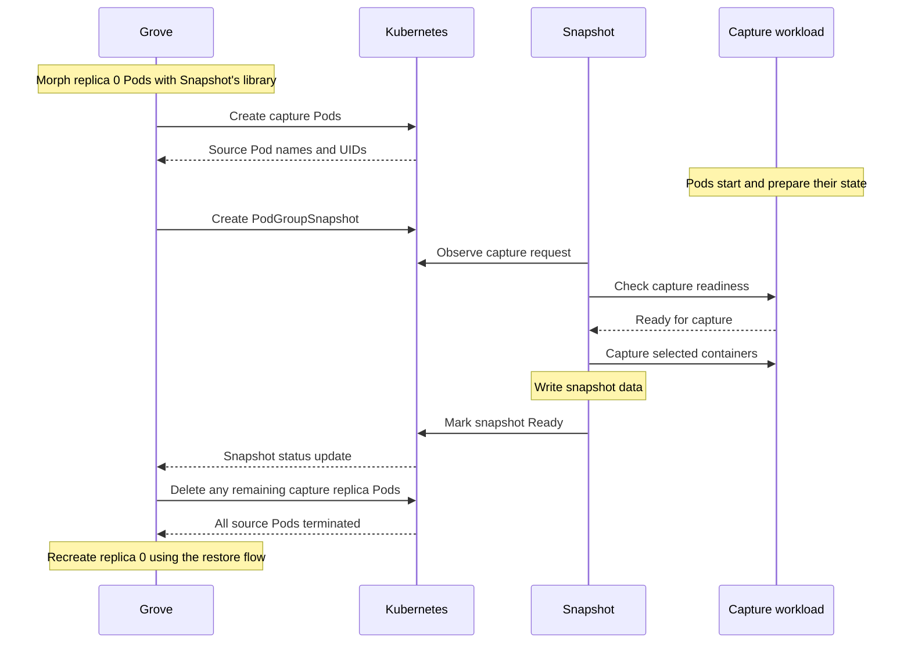
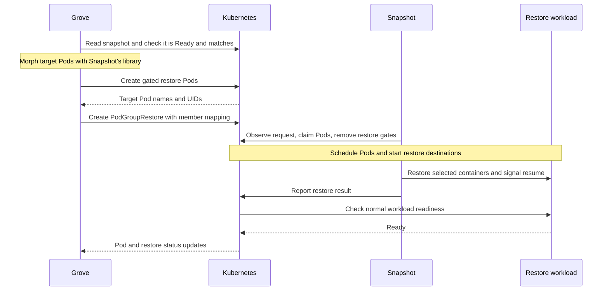

# GREP-1020: Snapshot capture and restore

<!-- toc -->
- [Summary](#summary)
- [Motivation](#motivation)
  - [Goals](#goals)
  - [Non-Goals](#non-goals)
- [Proposal](#proposal)
  - [Limitations/Risks &amp; Mitigations](#limitationsrisks--mitigations)
- [Design Details](#design-details)
  - [Configuration](#configuration)
    - [PCSG](#pcsg)
    - [Standalone PodClique](#standalone-podclique)
    - [Shared rules](#shared-rules)
  - [Pod preparation](#pod-preparation)
  - [Capture](#capture)
    - [Normal flow](#normal-flow)
    - [Failure and retries](#failure-and-retries)
  - [Restore](#restore)
    - [Normal flow](#normal-flow-1)
    - [Failure](#failure)
  - [Member mapping and reuse](#member-mapping-and-reuse)
    - [Existing group snapshots](#existing-group-snapshots)
  - [Monitoring](#monitoring)
  - [Open Questions](#open-questions)
    - [Capture retries](#capture-retries)
    - [Restore retries](#restore-retries)
    - [Passing Snapshot settings through](#passing-snapshot-settings-through)
    - [Recording the captured snapshot](#recording-the-captured-snapshot)
    - [Choosing how each replica starts](#choosing-how-each-replica-starts)
    - [Checking whether a snapshot still matches](#checking-whether-a-snapshot-still-matches)
    - [One Snapshot flow or two](#one-snapshot-flow-or-two)
  - [Test Plan](#test-plan)
  - [Graduation Criteria](#graduation-criteria)
<!-- /toc -->

## Summary

Grove can save a prepared replica as a snapshot and use it to start later
replicas. Users can also supply an existing snapshot. They choose which cliques
and containers to capture. Grove manages the Pods and requests; Snapshot saves
and restores their state.

## Motivation

Loading and preparing a workload can take a long time. Restoring a prepared
replica can shorten startup. Grove already manages replica creation and
replacement, so it can manage this flow too.

### Goals

- Capture once for a workload configuration and reuse that capture across replicas.
- Support a single-Pod workload and a group that spans several Pods.
- Let users select the captured containers and the helpers needed during capture.
- Preserve each member's role when restoring into new Pods.

### Non-Goals

- Implement checkpointing, artifact storage, or distributed coordination in Grove.
- Infer which application processes are safe to capture together.
- Move a workload without stopping it, or restore with a different set of members.

## Proposal

Users enable snapshot support on a PodCliqueScalingGroup (PCSG) or a standalone
PodClique. A PCSG replica contains the Pods of its member cliques. Each standalone
PodClique replica is one Pod. Workloads without snapshot support keep their
current behavior.

Without an explicit snapshot reference, Grove manages capture automatically.
When no matching snapshot exists, replica index 0 runs the capture workload.
Grove waits until capture succeeds, fails, or times out. On success, it recreates
replica 0 with new Pods that restore from the snapshot. Later replicas reuse it.

The startup policy defaults to `Immediate`:

| Snapshot state | Policy | Action |
| --- | --- | --- |
| Ready | Either | Restore new replicas. |
| Capture pending | `WaitForCheckpoint` | Replica 0 captures; other replicas wait. |
| Capture pending | `Immediate` | Replica 0 captures; other replicas may start cold. |
| Cannot be checked | Either | Report the error and retry the check. |

With `snapshotRef`, Grove uses the named snapshot and never captures. While that
snapshot is pending, every replica, including index 0, may start cold under
`Immediate` or wait under `WaitForCheckpoint`. A missing, failed, or incompatible
snapshot produces an error.

Grove chooses capture, cold start, or restore once for each new replica before
creating any member Pod. A restore never switches to cold start. Existing cold
replicas keep running when the snapshot becomes Ready.

### Limitations/Risks & Mitigations

Capture occupies replica index 0. With `Immediate` and one requested replica,
serving starts only after capture and restore. Request at least two replicas to
allow serving during capture.

## Design Details

### Configuration

These are partial PodCliqueSet (PCS) template entries; ordinary Pod templates
are omitted. New field names and placement are proposed. Deadline values are
examples, not defaults. Readiness and resume settings use Snapshot's API; how
Grove exposes those types is still open.

#### PCSG

Entry under `spec.template.podCliqueScalingGroups`:

```yaml
- name: model
  cliqueNames: [leader, worker, metrics]
  replicas: 2
  minAvailable: 1
  snapshot:
    startupPolicy: Immediate
    # snapshotRef: prepared-model  # Use an existing PodGroupSnapshot instead.
    captureDeadlineSeconds: 600
    restoreDeadlineSeconds: 300
    cliques:
      - name: leader
        containers: [engine]
        additionalContainers: [helper]
        podSnapshotTemplate:
          containers:
            - name: engine
              checkpointReadinessProbe:
                file: {path: /tmp/ready-for-snapshot}
              lifecycle:
                postRestore:
                  file: {path: /tmp/restore-complete}
      - name: worker
        containers: [engine]
        additionalContainers: [helper]
        podSnapshotTemplate:
          containers:
            - name: engine
              checkpointReadinessProbe:
                file: {path: /tmp/ready-for-snapshot}
              lifecycle:
                postRestore:
                  file: {path: /tmp/restore-complete}
```

Each selected clique supplies the Snapshot settings for its members. The metrics
clique starts normally and is not captured.

#### Standalone PodClique

Entry under `spec.template.cliques`, not named by any PCSG:

```yaml
- name: worker
  spec:
    roleName: worker
    replicas: 1
    snapshot:
      startupPolicy: WaitForCheckpoint
      # snapshotRef: prepared-worker  # Use an existing PodSnapshot instead.
      captureDeadlineSeconds: 600
      restoreDeadlineSeconds: 300
      containers: [engine]
      additionalContainers: [helper]
      podSnapshotTemplate:
        containers:
          - name: engine
            checkpointReadinessProbe:
              file: {path: /tmp/ready-for-snapshot}
            lifecycle:
              postRestore:
                file: {path: /tmp/restore-complete}
    # podSpec: the ordinary engine and helper container specifications.
```

This uses the same settings without a clique selection list. Storage settings and
capture-only startup overrides are not shown; their API shape remains open.

#### Shared rules

`snapshotRef` is an optional name-only string in the same namespace: a
`PodGroupSnapshot` for a PCSG, or a `PodSnapshot` for the standalone flow shown
above. Grove records the resolved identity for each restore attempt, so a new
object with the same name cannot replace it mid-attempt. Grove does not own or
delete externally supplied snapshots.

Each `snapshot.cliques` entry selects all Pods of that clique within one PCSG
replica. Omitted cliques stay in the replica but do not join capture or restore.

Grove builds capture Pods from the normal Pod templates:

| Container selection | Capture behavior |
| --- | --- |
| `containers` | Run and capture. Exactly one entry is supported today. |
| `additionalContainers` | Run without capturing. Omitted means none. |
| Other regular containers | Omit from capture Pods. |
| `initContainers` | Keep unchanged, including native sidecars. |

The lists must name existing regular containers, without duplicates or overlap.
Serving Pods keep all normal containers: selected containers restore; others
start fresh. Grove does not stop helpers while they are still doing capture work.
Startup commands, readiness and resume actions, storage options, and deadlines
come from the API. Grove forwards Snapshot settings without defining a second
version of each setting.

### Pod preparation

Before creating a Pod, Grove uses Snapshot's shared library to prepare its normal
template for capture or restore. The library adds the required volumes, probes,
and other settings. Grove supplies the container selection, member IDs, and
generated Pod references along with the user's workload settings.

### Capture

#### Normal flow



The diagrams show the multi-Pod flow. Kubernetes covers the API, scheduler, and
kubelet; Snapshot covers its operator, coordinator, and agents. Excluded cliques
and helpers run alongside capture.

While replica 0 is capturing, Grove waits for the snapshot result before starting
replacement Pods and lets the other capture members finish.

After Snapshot reports success, Grove deletes any remaining source Pods and waits
for them all to terminate. It then recreates replica 0 in restore mode with new
Pod UIDs.

#### Failure and retries

On failure, Grove records the reason and deletes the whole capture replica.
After all its Pods terminate and a retry delay passes, Grove creates new capture
Pods at index 0 and a new snapshot request. The failed request stays failed.
Retries stop at a limit, after which a user must request another attempt. A
controller restart does not reset the count. Existing cold replicas keep running.

### Restore

#### Normal flow



Grove prepares the selected Pods with Snapshot's library, including a scheduling
gate that holds them until Snapshot claims them. It then creates a
`PodGroupRestore` mapping each captured member to a new Pod by name and UID.
Snapshot removes its gate, waits for placement, and restores the selected
containers. Other containers and excluded cliques start normally. The workload's
normal probes determine when it can serve.

#### Failure

A failed restore can leave some members running. Grove deletes the whole failed
replica and waits for every Pod to terminate before any retry. The restore retry
policy remains open.

### Member mapping and reuse

For automatic capture, Grove assigns each Pod a stable member ID from its clique
and Pod index within that clique:

| Member ID | Capture source | Restore target |
| --- | --- | --- |
| `leader-0` | Original leader | New leader |
| `worker-0` | Original worker 0 | New worker 0 |
| `worker-1` | Original worker 1 | New worker 1 |

Grove lists capture members in `snapshot.cliques` order, then Pod index order.
Snapshot records that order, but restore matches by member ID. New Pod names,
UIDs, and nodes do not change the mapping. The first member need not be the
workload leader. IDs must be unique and fit Snapshot's name limits.

#### Existing group snapshots

By default, Grove expects the same member IDs when using an existing snapshot.
If that snapshot uses different IDs, users can set `memberIDs` on each selected
clique. For example, with one leader Pod and two worker Pods:

```yaml
snapshot:
  snapshotRef: existing-capture
  cliques:
    - name: leader
      containers: [engine]
      memberIDs: [saved-head]
    - name: worker
      containers: [engine]
      memberIDs: [saved-worker-a, saved-worker-b]
```

Each `memberIDs` entry names a captured member for the corresponding Pod index
within that clique: `saved-head` goes to leader Pod 0; `saved-worker-a` and
`saved-worker-b` go to worker Pods 0 and 1. Grove then writes these IDs and the new
Pod names and UIDs into the `PodGroupRestore` targets.

Before creating restore targets, Grove checks that each selected clique has one
ID per Pod, that IDs are unique across cliques, and that every captured member
is mapped exactly once. It never guesses the mapping from the snapshot's list
order.

Reuse also requires a matching workload configuration, such as images, container
settings, and member counts. Checks compare the mapped members. Which settings
to compare remains open below.

### Monitoring

Grove status shows capture progress, the selected snapshot, and Snapshot's failure
reason. Exact status fields and events remain open.

### Open Questions

#### Capture retries

How many times should Grove retry capture, and how long should it wait between
attempts? How does a user request another attempt after reaching the limit?

#### Restore retries

Should Grove retry a failed restore automatically? If so, how many times and with
what delay?

#### Passing Snapshot settings through

Should Grove reuse Snapshot's API types or accept a block of settings that it
forwards unchanged? Reusing types gives typed validation, but exposing new fields
requires updating Grove's Snapshot dependency and CRDs. Forwarding settings can
avoid that update only when Grove does not need to act on the new fields itself.

#### Recording the captured snapshot

Where should Grove record the snapshot produced by automatic capture? Proposed:
PCS status, with an entry per PCSG or standalone clique and workload revision.
Choose one controller to own that record.

#### Choosing how each replica starts

How does Grove keep one decision for all Pods of a replica: capture, cold start,
or restore? Proposed: choose before creating any member, then pass the decision
down to Pod creation. Confirm how later reconciles and controller restarts keep
that same decision.

#### Checking whether a snapshot still matches

Which workload changes require a new snapshot? Proposed: reuse Dynamo's versioned
configuration hash, sharing generic code where possible. The hash is a
fingerprint of the settings used for capture. Define which settings it covers,
including group membership, and where to store it.

#### One Snapshot flow or two

Should Grove use one flow for both single-Pod and multi-Pod workloads? Snapshot
currently has two:

| Workload | Capture request | Restore request |
| --- | --- | --- |
| Single Pod | `PodSnapshot` | Annotations on a new Pod; no restore resource. |
| Group of Pods | `PodGroupSnapshot` | `PodGroupRestore` |

Proposed: use the group flow everywhere in Grove, with groups of one for
standalone PodClique replicas. Replica 0 captures; later replicas reuse it. This
would require extending Snapshot to restore existing standalone snapshots through
`PodGroupRestore`. Should we make that change or keep both flows in Grove?

### Test Plan

Extend the PodClique and PCSG controller tests and add end-to-end coverage for:

- Container selection, helpers, and member mapping into new Pod identities.
- Default member IDs and explicit mappings for existing group snapshots; refuse
  missing, extra, duplicate, or incorrectly sized mappings.
- Both startup policies, with automatic capture and existing snapshots.
- One startup decision per replica across reconciles and controller restarts.
- Waiting for the capture result before replacing replica 0 in restore mode.
- Capture retries that wait for cleanup and stop at the limit across restarts.
- Deleting the whole failed restore replica before any retry.
- API errors causing no cold start, and external snapshots never being deleted.
- Workloads without snapshot support keeping their existing behavior.

### Graduation Criteria

Open: which features and tests are required for alpha, beta, and stable releases?
